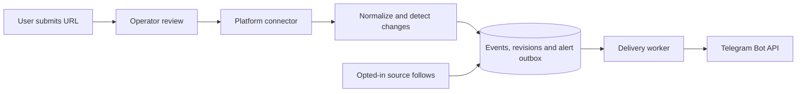

# Running the alert pipeline

Event Bank is free software under AGPL-3.0-only. Each installation runs Django, PostgreSQL and
one worker. No Redis, Celery, paid AI service, or scraping subscription is required. Telegram's
normal bot messaging is free within its limits; hosting, internet access, SMS and WhatsApp can
still incur costs. See [Telegram](https://core.telegram.org/bots/faq#broadcasting-to-users),
[WhatsApp pricing](https://business.whatsapp.com/products/platform-pricing), and
[mNotify terms](https://www.mnotify.com/terms).

## Flow



Only supported URLs can be registered. See `GET /api/platforms/` for available connectors and
[adding a connector](adding-a-connector.md) to support another platform. A page needs a suitable
API, feed, JSON-LD, or a platform-specific parser; there is no universal HTML scraper. The operator
reviews whether a source is relevant to tech events and suitable to access/reuse before approval.
Existing Luma access caveats in the README still apply.

## Start locally

```bash
cp .env.example .env
docker compose up --build -d
docker compose exec backend python manage.py createsuperuser
```

The backend applies migrations at startup. For an existing running backend after updating code:

```bash
docker compose exec backend python manage.py migrate
```

Create a Telegram bot using BotFather in Telegram. Add its token to your local `.env` (never to
Git, source config, a URL submission, or a chat command):

```dotenv
TELEGRAM_BOT_TOKEN=<your BotFather token>
TELEGRAM_SENDING_ENABLED=true
INGESTION_SCHEDULING_ENABLED=true
INGESTION_INTERVAL_SECONDS=3600
```

Recreate the services to load the changed environment. The `worker` service runs `run_worker`
and restarts automatically:

```bash
docker compose up -d --force-recreate backend worker
docker compose logs -f worker
```

The worker uses polling, so Telegram does not need an inbound webhook or publicly reachable
server. Use a dedicated bot without an active webhook; polling and webhooks cannot run together.
Only one Event Bank worker is allowed per database. Keep the worker and database running for
ongoing alerts. `--once` processes one cycle and exits; it is not a dry run. Sending and scheduled
ingestion remain disabled by default until their separate environment flags are enabled.

## User experience

Message your bot in a **private chat**:

1. `/start` shows help without subscribing you.
2. `/platforms` lists supported platforms.
3. `/add HTTPS_URL` submits a source for operator review (up to five submissions and ten attempts
   per day; failed attempts count too).
4. An operator approves it at `/admin/`, under Sources.
5. `/sources` lists the first 30 approved sources and their IDs. The paginated `/api/sources/`
   endpoint lists the full catalogue.
6. `/follow SOURCE_ID` explicitly opts in to future alerts for that source (up to 50 follows).
7. `/unfollow SOURCE_ID` stops one source; `/stop` stops all event alerts and removes follows.

Following an existing source does not backfill old revisions. To test the complete flow, follow a
newly approved source, then run:

```bash
docker compose exec backend python manage.py ingest_source <source-id>
```

Successful ingestion automatically queues new and significant-change alerts. If one ingestion run
would send a subscriber more than five alerts (for example a source's first import), they get a
single digest instead: the count, the first five events with links, and "…and N more." The running worker
delivers them after the database commit. It does not send a message for unchanged events, title/
description-only edits, past events, or events without a confirmed start date. Source polling
runs at most hourly by default; alerts follow detection, not necessarily the organiser's edit time.
Sources with dates only produce all-day records rather than invented start times.

Messages include the event title, start date/time, timezone, location, status, registration link,
source ID, unsubscribe instruction and the dataset's short credit line (e.g. confs.tech's MIT
credit with a link to its licence). `/stop` and `/unfollow` cancel queued alerts and digests; a
send already in flight may still arrive. Command replies are always sent before queued alerts, so
an unsubscribe confirmation never waits behind a backlog.

If a command can't be processed, the bot replies with a generic error and moves on to the next
message, so one malformed message can't block the bot.

## API for integrations and a future frontend

- `GET /api/events/?location=Accra&attendance=in_person`: paginated upcoming/ongoing events, and
  `GET /api/events/<id>/`. See the README's Events API section for all filters.
- `GET /api/sources/`: paginated approved sources, without private config or submitter details.
- `GET /api/platforms/`: connector names and supported hostnames.
- `POST /api/sources/submit/`: session-authenticated source submission; fields are `url`, optional
  `name`, and optional IANA `timezone`. Requires a valid CSRF token. Always creates pending sources.

No public account-signup or frontend is included yet. An operator can create Django accounts in
admin; Telegram users can submit sources without a Django account. Bot submissions cannot specify
credentials or connector config. Operators use `add_source --config ...` or edit approved config
in admin when needed. A duplicate `/add` only reveals the existing source ID if it is approved;
pending or rejected submissions stay private.

## Delivery guarantees and operations

Events, revisions and alert rows commit atomically. A failed import produces no alerts. Each
subscriber/revision pair has one delivery key, and a newer significant revision cancels older
pending alerts for that event. The database records pending, sending, accepted, rejected,
unknown and cancelled states. View deliveries and subscribers in Django admin.

Only connection failures known not to have sent a request and explicit rate limits are retried,
up to three attempts. Telegram's retry delay is respected. Timeouts after sending, malformed
responses and server errors are `unknown` and never automatically resent. A worker crash can
leave an uncertain send; after five minutes it becomes `unknown`. This is not exactly-once
delivery and may lose a message under uncertainty. Do not reset unknown rows automatically.

The worker paces private-chat sends at 1.1 seconds per message and never enables paid broadcasts.
Each cycle polls Telegram, ingests up to `INGESTION_SOURCES_PER_CYCLE` due sources (default 2,
so a slow source can't hold up polling for long) and sends up to 20 deliveries. A failing cycle is
logged and retried with backoff; the worker doesn't exit. Run a small pilot before increasing
volume. No live Telegram delivery has been verified
without operator credentials; tests use mocked responses and synthetic chat IDs.

All API/provider credentials stay in environment variables. Subscriber chat IDs and consent
timestamps are stored for routing; incoming message bodies and Telegram user profile names are
not retained. `/stop` is an opt-out, not an immediate erasure. After `DATA_RETENTION_DAYS` (default
30) the worker deletes finished deliveries, `/add` attempt records and subscribers who stopped or
never opted in (see [deployment](deployment.md#data-retention)). An operator can delete a
subscriber earlier in admin, cascading their follows, source requests and deliveries. A production
operator should publish retention/contact information appropriate to their installation.

## Contributing another notification channel

Providers implement `NotificationProvider.send()` and return `SendResult`, distinguishing
accepted, rejected, retryable and unknown outcomes. Keep provider HTTP logic in
`apps/notifications/providers/`, and use mocked HTTP in tests.

The current subscriber/delivery routing is Telegram-only. The mNotify client exists but is not
wired to this workflow. SMS still needs verified phone opt-in, channel-aware destinations, STOP
handling and cost controls. WhatsApp needs its official adapter, opted-in destinations and
approved templates where applicable. Do not substitute unofficial WhatsApp session automation.
Those integrations can reuse the outbox pattern, but they are not enabled by the Telegram flag.
